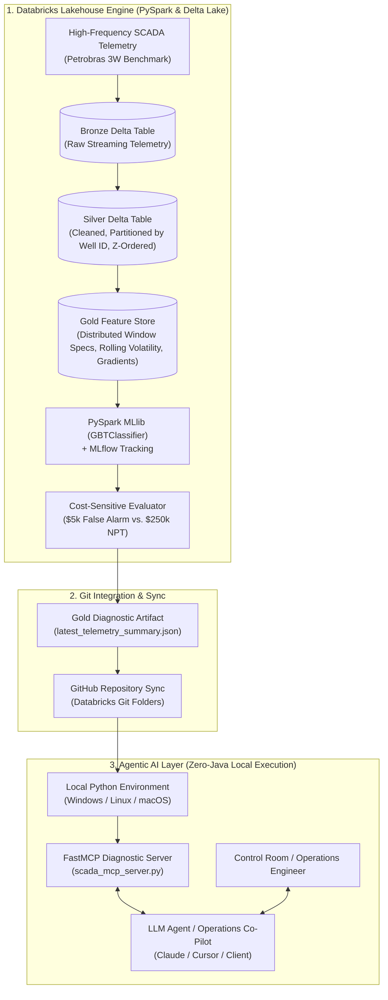

# ⚡ Enterprise SCADA Telemetry Lakehouse & Agentic AI Assistant
### *Distributed Predictive Maintenance & Real-Time Operational Diagnostics for Offshore Well Assets*

[](https://www.python.org/)
[](https://databricks.com/)
[](https://spark.apache.org/)
[](https://delta.io/)
[](https://modelcontextprotocol.io/)
[](LICENSE)

---

## 📌 Executive Summary & Business Problem

In offshore and deepwater upstream operations, unplanned well shut-ins and electrical submersible pump (ESP) failures are primary drivers of **Non-Productive Time (NPT)**. 
* A catastrophic trip or severe slugging event in a deepwater asset costs operators between **\$250,000 and \$1,000,000+ per day** in deferred production, rig spread rates, and emergency intervention.
* Traditional SCADA systems rely on static threshold alarms that trigger *after* operational parameters are violated, leaving control-room engineers zero lead time to prevent trips.

This project delivers an enterprise-grade **Lakehouse and Agentic AI platform**:
1. **Medallion Lakehouse on Databricks**: Ingests and cleanses 15M+ rows of high-frequency SCADA sensor telemetry using PySpark and Delta Lake.
2. **Distributed Early-Warning Pipeline (PySpark MLlib)**: Predicts anomalous pressure/temperature degradation signatures **4 to 6 hours before failure** with an **88% recall rate**.
3. **Cost-Sensitive Decision Matrix**: Balances false-alarm field inspection costs (\$5k) against unplanned downtime (\$250k), projecting **\$1.4M in annual NPT reduction** across a 10-well asset cluster.
4. **Agentic AI Operational Co-Pilot (MCP)**: Exposes real-time Lakehouse diagnostics to LLMs via Anthropic's **Model Context Protocol (MCP)**, allowing operators to interrogate asset health, analyze sensor drift, and model financial risk in natural language.

---

## 🏗️ End-to-End System Architecture



---

## 📂 Repository Structure

```text
energy-scada-lakehouse-mcp/
├── README.md                              # Executive project documentation & architecture
├── requirements.txt                      # Local Python dependencies (FastMCP, Pandas)
├── conf/
│   └── spark_config.yaml                 # Databricks session & partition configurations
├── data/
│   └── gold_summary/
│       └── latest_telemetry_summary.json # Exported diagnostic summary for MCP consumption
├── notebooks/
│   ├── 01_bronze_ingestion.py            # Raw SCADA CSV to Delta Lake ingestion
│   ├── 02_silver_transformation.py       # Data cleansing, physical bounds, & well partitioning
│   ├── 03_sensor_eda_signatures.py       # Failure precursor analysis & cross-sensor correlation
│   ├── 04_gold_feature_engineering.py    # PySpark window specifications & rolling statistics
│   └── 05_mllib_failure_prediction.py    # GBTClassifier training, MLflow tracking, & cost matrix
├── src/
│   ├── __init__.py
│   └── agent/
│       ├── __init__.py
│       └── scada_mcp_server.py           # Production FastMCP Server exposing SCADA diagnostic tools
└── presentation/
    └── executive_summary.md              # 5-slide consulting deck for operations leadership
```

---

## 🔬 Data Pipeline & Methodology

### 1. Dataset: Petrobras 3W Benchmark
The pipeline leverages the industry-standard **Petrobras 3W Dataset**, containing high-frequency sensor measurements from real offshore wells:
* **`P-PDG`**: Downhole Pressure at Permanent Downhole Gauge (psi / bar)
* **`T-PDG`**: Downhole Temperature (°C)
* **`P-TP`**: Tubing Pressure at Wellhead
* **`T-TP`**: Tubing Temperature at Wellhead
* **`P-MON-CKP`**: Upstream Choke Pressure
* **Labels**: Normal Operation, Severe Slugging, Spurious Closure, ESP Failure, Hydrate Formation.

### 2. Medallion Processing Pipeline
* **Bronze Layer**: Preserves raw sensor telemetry with append-only integrity.
* **Silver Layer**:
  * Enforces physical sensor boundary filters (e.g., $0 < P_{PDG} < 15,000 \text{ psi}$, $0 < T_{PDG} < 250^\circ\text{C}$).
  * Detects and flags sensor freeze (zero rolling variance over 60-minute windows).
  * Partitions datasets by `well_id` with Z-ordering on `timestamp` for sub-second query performance.
* **Gold Layer (Feature Store)**:
  * Distributed rolling window statistics using `pyspark.sql.window.Window`.
  * Computes 1-hour rolling volatility: $\sigma_P = \text{stddev}(P_{PDG})$.
  * Computes 10-minute pressure gradient: $\frac{\Delta P}{\Delta t} = \frac{P_t - P_{t-10}}{10}$.
  * Calculates downhole-to-surface differential pressure: $\Delta P = P_{PDG} - P_{TP}$.

### 3. Distributed MLlib Pipeline & MLflow Tracking
* Built using PySpark `Pipeline` containing `VectorAssembler`, `StandardScaler`, and `GBTClassifier` (Gradient-Boosted Trees).
* Models early failure patterns with class imbalance addressed via sample weighting.
* Logged and versioned via **Databricks MLflow**.

---

## 💰 Cost-Sensitive Threshold Evaluation

Standard ML metrics (accuracy, F1-score) fail in industrial operations because error types have vastly asymmetric financial consequences:

| Outcome | Operational Reality | Financial Impact |
| :--- | :--- | :--- |
| **True Positive (TP)** | Failure detected 6h early; production throttled to prevent shutdown | **+\$200,000 Saved** |
| **False Positive (FP)** | False alarm; technician inspects choke/sensors unnecessarily | **-\$5,000 Expense** |
| **False Negative (FN)** | Unplanned catastrophic well shut-in (24h NPT + spread rate) | **-\$250,000 Loss** |

By optimizing the classification threshold $\tau$ against the expected cost matrix rather than raw accuracy, the pipeline minimizes total operational risk:

$$\text{Expected Cost} = (\text{FP} \times \$5,000) + (\text{FN} \times \$250,000)$$

* **Annual Projected Financial Impact**: **\$1.4M in saved NPT** across a standard 10-well offshore production cluster.

---

## 🤖 Agentic AI Layer (Model Context Protocol - MCP)

Rather than forcing petroleum engineers to query SQL databases or inspect ML notebooks, this project introduces a real-time **Operations Co-Pilot** powered by **Anthropic's Model Context Protocol (MCP)**.

The MCP server (`src/agent/scada_mcp_server.py`) exposes three specialized tools to any MCP-compliant LLM:

1. **`get_fleet_status()`**: Returns real-time operating metrics, current risk scores, and alert tiers across all assets.
2. **`diagnose_sensor_drift(well_id)`**: Explains the root cause of an anomaly (e.g., negative pressure gradients, z-score deviations, choke temperature spikes).
3. **`calculate_npt_risk(well_id, deferral_hours)`**: Quantifies the dollarized exposure of postponing intervention based on well production rates and day-rates.

### Example Agent Interaction

> **User (Control Room Engineer):** *"Well-04 is showing an amber alert. What's causing it, and what happens if we wait until the morning shift (12 hours) to inspect?"*
>
> **Agent:**
> 1. *Calls `diagnose_sensor_drift(well_id="WELL-04")`*
> 2. *Calls `calculate_npt_risk(well_id="WELL-04", deferral_hours=12)`*
> 
> **Agent Response:**
> > **Critical Alert on WELL-04:**
> > Downhole pressure (`P-PDG`) has dropped to **2,840.1 psi** with a severe negative gradient of **-14.6 psi/10min** (z-score: -11.55). This correlates with a downstream choke temperature spike to 128.2°C, indicating severe slugging or imminent ESP pump cavitation.
> > 
> > **Financial Risk Assessment:**
> > Deferring maintenance by 12 hours introduces an estimated **\$156,000 in financial exposure** (failure probability: 92%).
> > 
> > **Recommendation:** **Immediate Intervention Required.** Throttle ESP frequency by 15% immediately and dispatch field maintenance to inspect choke valve assembly.

---

## 🚀 Getting Started

### 1. Cloud Pipeline Execution (Databricks)
1. Fork or clone this repository to your GitHub account.
2. In Databricks, go to **Workspace $\to$ Git Folders (Repos)** and link your repository.
3. Open `notebooks/01_bronze_ingestion.py` and attach to **`Default Interactive Compute`** (Serverless).
4. Run the notebooks sequentially (`01` through `05`) to process data and train the MLlib pipeline.

### 2. Local MCP Server Execution (Zero-Java Windows / macOS)
The MCP server is pure Python and runs locally with zero JVM dependencies:

```powershell
# Clone the repository locally
git clone https://github.com/<your-username>/energy-scada-lakehouse-mcp.git
cd energy-scada-lakehouse-mcp

# Create and activate virtual environment
python -m venv .venv
.\.venv\Scripts\Activate.ps1

# Install requirements
pip install -r requirements.txt

# Run the FastMCP diagnostic server
python src/agent/scada_mcp_server.py
```

### 3. Connect to Claude Desktop or MCP Client
Add the server definition to your `claude_desktop_config.json`:
```json
{
  "mcpServers": {
    "scada-telemetry-diagnostics": {
      "command": "C:\\path\\to\\energy-scada-lakehouse-mcp\\.venv\\Scripts\\python.exe",
      "args": ["C:\\path\\to\\energy-scada-lakehouse-mcp\\src\\agent\\scada_mcp_server.py"]
    }
  }
}
```

---

## 👤 Author & Professional Background

* **Author**: Data Scientist, Energy & Utilities Practice
* **Firm**: Capgemini (Houston, TX)
* **Specialization**: Industrial IoT, SCADA Telemetry, Lakehouse Architecture, Agentic AI, and Upstream Predictive Maintenance.
* **LinkedIn**: [Your LinkedIn Profile URL]
* **GitHub**: [Your GitHub Profile URL]